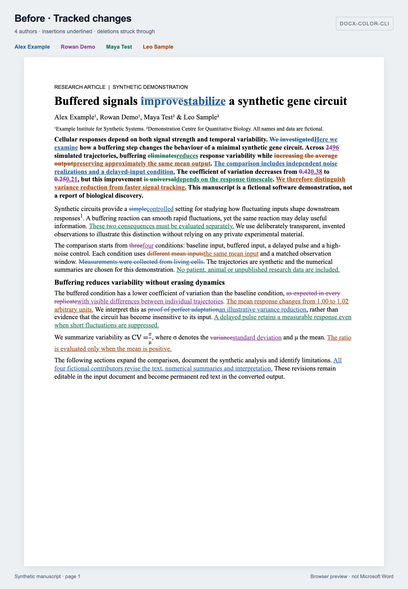
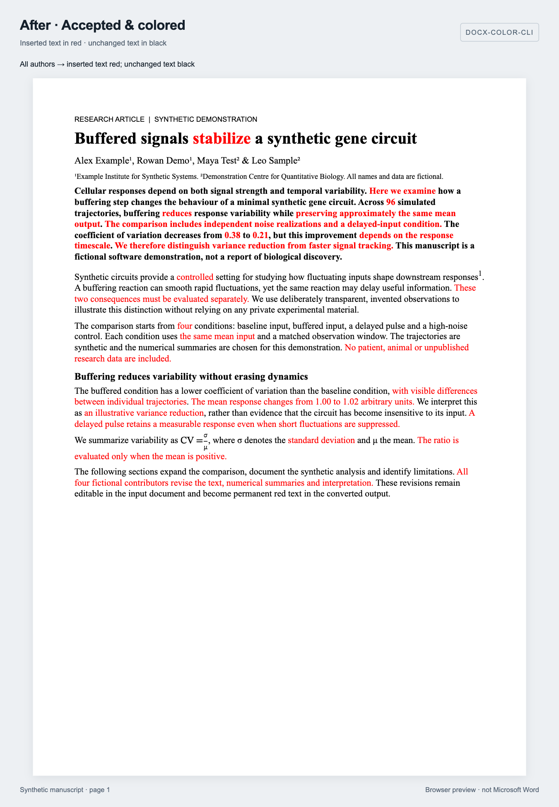

# docx-color-cli

Accept tracked changes in Word documents and turn inserted text into permanent
font colors.

`docx-color-cli` converts a tracked DOCX into a new DOCX with insertions in red,
unchanged text in black, and deleted content removed. It works directly with
OOXML and keeps supported document structures and editable fields intact.

**Python 3.11+ · DOCX → DOCX · Runtime dependency: lxml**

The project is under active development. Content fidelity takes priority over
formatting and performance. Supported revisions are accepted; unsupported or
ambiguous structures cause an error before the output is published. Compatibility
with every Word document and identical rendering in Microsoft Word are not guaranteed.

## Installation

Install from a local source checkout. The commands below do not assume a release
is available on PyPI.

### With uv

From the project directory, install the CLI in an isolated tool environment:

```bash
uv tool install .
docx-color --help
```

### With pip

Use an activated Python 3.11+ virtual environment:

```bash
python -m pip install .
docx-color --help
```

Microsoft Word and LibreOffice are not required. PDF conversion is not supported.

## Quick start

```bash
docx-color manuscript.docx manuscript_colored.docx
```

| Content in the original document | Output |
| --- | --- |
| Inserted text | Retained in red (`FF0000`) |
| Unchanged text | Retained in black (`000000`) |
| Deleted text | Removed |
| Replaced text | Old text removed; replacement retained in red |
| Supported moved text | Source removed; destination retained in red |

Supported revisions are accepted, leaving no unhandled revision markers in the
published output. Existing text colors are intentionally replaced by these colors.

Omit the output path to create `<input_stem>_colored.docx` beside the input:

```bash
docx-color manuscript.docx
```

Write conversion statistics to a JSON report:

```bash
docx-color manuscript.docx manuscript_colored.docx --report report.json
```

Choose different insertion and unchanged-text colors:

```bash
docx-color manuscript.docx manuscript_colored.docx --red 0000FF --black 000000
```

## Example: a Nature-style manuscript

Try the included, four-page synthetic manuscript (approximately 1,450 words after acceptance). Its title, author block, bold
summary, numbered citation, references, table and Methods follow an abridged
structure inspired by [Nature's formatting guide](https://www.nature.com/nature/for-authors/formatting-guide).
All names, data and the numbered reference are fictional; this is not an official
Nature template or a published paper.

Download the [tracked input](examples/tracked.docx) and
[converted output](examples/colored.docx), or run from the checkout:

```bash
uv run docx-color examples/tracked.docx examples/colored.docx
```

Four fictional authors contribute **124 revision markers: 73 insertions and 51
deletions** across the title, summary, results, discussion, Methods and table.
The converted document preserves two equations and editable citation/hyperlink fields.

| Before: tracked revisions | After: accepted and colored |
| --- | --- |
|  |  |

Screenshots show the actual DOCX files' first pages rendered in a browser with
[docx-preview](https://github.com/VolodymyrBaydalka/docxjs). They are **not Microsoft
Word screenshots** or evidence of identical Word layout. The input preview uses
distinct colors for each author, underlined insertions and struck-through deletions;
author names are read from the DOCX revision metadata. Output colors come from
the converted DOCX. See [example details](examples/README.md).

## Command-line reference

```text
docx-color [-h] [--red RED] [--black BLACK] [--report REPORT]
           [--no-strict] input [output]
```

| Argument | Description | Default |
| --- | --- | --- |
| `input` | Source DOCX containing tracked changes | Required |
| `output` | Destination DOCX | `<input_stem>_colored.docx` |
| `--red` | Color for inserted text, as six hexadecimal digits without `#` | `FF0000` |
| `--black` | Color for unchanged text, in the same format | `000000` |
| `--report` | Path for a JSON conversion-statistics report | No report file |
| `--no-strict` | Legacy compatibility option; does **not** bypass safety checks | Disabled |
| `-h`, `--help` | Show command help | — |

Successful conversion prints the output path and statistics. Errors return a
nonzero exit status. The JSON report contains operation counts, not a certification
of equivalence with Microsoft Word.

## Supported documents and revisions

- Text insertions, deletions and replacements, including split runs and nested
  insertion/deletion revisions.
- Supported paragraph-mark insertions and deletions, including adjacent paragraph
  merges with different properties. The final surviving paragraph mark determines
  the merged paragraph's properties.
- Paired inline, whole-paragraph and cross-paragraph moves within the same document
  part, subject to structural boundary checks.
- Text changes within table cells and ordinary table-row insertions and deletions.
  Inserted rows use text-level revision markers to determine text color.
- Supported mathematical run revisions, nested run revisions, inserted equation
  controls and fully deleted equation objects. Partially retained objects are
  never discarded merely because their control is marked deleted.
- Supported formatting revisions, retaining current properties and removing
  historical snapshots.

The converter preserves supported hyperlinks, bookmarks, images, OMML equations,
content controls, headers, footers, footnotes and endnotes. Word fields, cross-references
and Zotero citation/bibliography fields remain editable rather than being flattened
into plain text. Fields are preserved, not recalculated.

Images proven unused after revision acceptance are cleaned up without recompressing
retained images. Equation containers made empty by accepted deletions and comments
that lose their final active reference are cleaned up with dependency checks.

## Limitations

The converter targets the final content shown in Word's **No Markup** view.
That view is not equivalent to simply removing revision tags, and complete Word
compatibility has not been established.

The following cases are currently rejected or unsupported:

- Strict OOXML documents and unknown revision types.
- Unpaired moves, nested move containers, moves across cells or document parts,
  and move ranges that share moved content.
- Paragraph merges across sections, cells or tables, and unsupported terminal
  deleted paragraph marks.
- Cell insertion/deletion/merge revisions, row revisions involving vertical or
  legacy horizontal cell merges, and table-property exception revisions
  (`tblPrExChange`).
- Custom XML revision ranges, unsupported or conflicting math revisions, and
  equation-control deletions with retained or unrecognized content.
- Comment cleanup with unresolved dependencies, including surviving threaded replies.

A known run-property ordering defect remains when inserting color properties
([audit](docs/code_audit.md), CF017). Internal checks cover ZIP/XML integrity,
relationships, fields, revision removal and retention invariants; they are not a
complete OOXML schema validator or a rendering engine.

Independent Word-reference comparison is available in the test suite, not as a
CLI validation mode. Bounded semantic comparison of the local academic sample's
body passes; strict full comparison still detects representation and metadata
differences. This is evidence for the tested sample, not a guarantee for all documents.

## File safety

The input document is preserved. Input, output and report paths must identify
different files; checks include resolved paths, symbolic links and existing hard
links.

Output is written to a temporary file beside the destination and checked before
atomic replacement. Conversion or validation failure preserves an existing output.
**Successful conversion replaces an existing destination file.**

The optional report is published before the DOCX. These are separate atomic
operations: if final DOCX publication fails, the report may already contain the
attempted conversion's statistics.

## Documentation and contributing

Read [AGENTS.md](AGENTS.md) for development invariants and contribution guidance.
Reproduce content defects with a minimal synthetic fixture and add a regression
test before changing revision-processing behavior. Do not submit confidential
documents as public issue attachments.

- [Code audit and known issues](docs/code_audit.md)
- [Test results and validation scope](docs/test_report.md)
- [Repair plan](docs/fix_plan.md)
- [File safety and P0 repairs](docs/p0_fix_report.md)
- [Hyperlink semantic comparison](docs/hyperlink_h_report.md)

## License

Licensed under the [MIT License](LICENSE).
