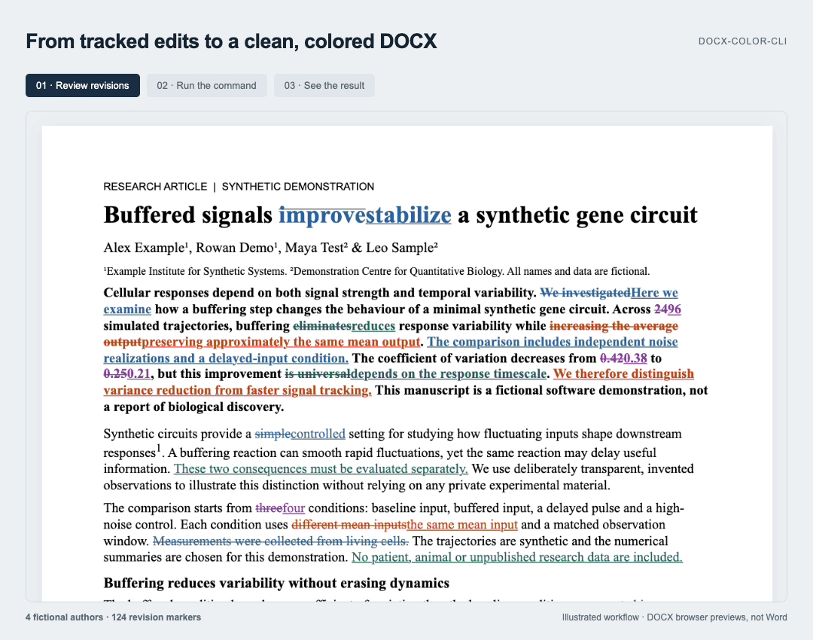

# docx-color-cli

[](https://pypi.org/project/docx-color-cli/)

[](https://github.com/colabomics/docx-color-cli/actions)
[](LICENSE)

[简体中文](README.zh-CN.md) | English

---

### Finished revising your manuscript? Now you have to color every change manually? 😩

Responding to reviewers is already exhausting enough. You've finally finished revising your manuscript, only to realize you still need to track down every new sentence, paragraph, and equation—and turn them all red.

**Surely there's a better use of your time.**

Meet **docx-color-cli**! It uses Word's tracked changes to find newly added content and color it in your final document.

**One command. All the red you need. 🔴**

## ✨ Why docx-color-cli?

Picture this:

You've spent weeks responding to reviewers.

Reviewer #2 asked for more experiments, more analyses, and a few extra equations. You've finally addressed everything.

Just when you think you're ready to resubmit, the editor reminds you:

**"Please highlight all changes in the revised manuscript."**

And there you are, scrolling through Word, hunting down every addition...

😵‍💫

That's where `docx-color-cli` comes in.

- 🔴 **Automatically colors additions** — No more hunting down changes and coloring them one by one.
- 📄 **Keeps your document intact** — Text, equations, tables, references, and formatting stay where they belong.
- ⚡ **One command does the job** — No complicated setup or endless clicking.
- 🔓 **Free, open source, and local** — Your manuscript stays on your computer.

**Spend your time doing science, not fighting Word formatting.**

## 🎬 See It in Action



**Two Word documents. One command. Newly added text turns red! 🔴**

Prepare a document with tracked changes (`change_tracked.docx`) and a copy with all changes accepted (`change_accepted.docx`). Then run:

```bash
docx-color \
  examples/change_tracked.docx \
  examples/change_accepted.docx \
  examples/change_colored.docx
```

**🎉 Done!**

The tool automatically identifies additions and colors the text it can reliably locate in red. Unchanged content keeps its original formatting, while equations, tables, and references are preserved as much as possible.

**Want to try it yourself?** Both example Word documents are included in the [`examples/`](examples/) directory. Just run the command above and see the magic happen!

## 🚀 Three Steps. That's It.

### Step 1: Install

You'll need **Python 3.11 or newer**.

The new version hasn't been officially released yet, so for now, install it from a local checkout of the latest development code:

```bash
python -m pip install .
```

Or, if you're using [uv](https://docs.astral.sh/uv/):

```bash
uv tool install .
```

Once the new version is released, installation will be even easier:

```bash
uv tool install docx-color-cli
```

### Step 2: Prepare two Word documents

You'll need **two versions of the same manuscript**.

**📄 `tracked.docx` — Your manuscript with tracked changes**

This is the document you've been editing with Microsoft Word's Track Changes feature.

**📄 `accepted.docx` — The same manuscript with all changes accepted**

Creating it is easy:

1. Open `tracked.docx` in Microsoft Word.
2. Save a separate copy so your original stays untouched.
3. Go to **Review → Accept → Accept All Changes**.
4. Turn off Track Changes and save the copy as `accepted.docx`.

Make sure both files represent the same revision. Don't make additional content edits to one file after creating the accepted copy.

**A quick heads-up:** `docx-color-cli` doesn't accept revisions for you. You'll need to do that in Word first.

### Step 3: Run!

Open your terminal and type:

```bash
docx-color tracked.docx accepted.docx colored.docx
```

**🎉 Done!**

You'll get a new file:

`colored.docx`

Newly inserted content that can be reliably identified will be colored red.

Your original two Word documents remain untouched.

The whole workflow:

**📝 Tracked manuscript + ✅ Accepted manuscript → 🔴 Colored manuscript**

## 🎨 Not a Fan of Red? Pick Another Color!

Red is the default, but maybe your journal prefers blue.

No problem:

```bash
docx-color tracked.docx accepted.docx colored.docx --color 0000FF
```

You can use any six-digit hexadecimal color code. Just leave out the `#`.

## 📋 What Happens to My Manuscript?

| Content | What happens |
|---|---|
| ✏️ Newly added text | Automatically colored red |
| 📄 Unchanged text | Original color and formatting preserved |
| 🗑️ Deleted text | Already removed when you accepted the changes |
| ∑ Mathematical equations | Supported newly inserted equations are colored |
| 📊 Tables and images | Content and structure preserved |
| 📚 References | Citation fields and hyperlinks preserved |

Here's the important part:

**The tool doesn't rebuild your manuscript. It works directly with your accepted Word document and changes the colors of identified additions.**

Your equations stay editable. Your references stay where they belong.

And if something is too ambiguous to identify safely, the tool leaves it alone rather than making a wild guess.

## 📊 How Do I Know If Anything Was Missed?

After processing, the terminal tells you how things went.

You might see one of three statuses:

**✅ SUCCESS — All checks passed**

Your document was created and validated, with no unresolved coloring candidates reported.

**🟡 PARTIAL — Almost there!**

Your document was created, but some complex changes couldn't be colored reliably, or there was a problem saving the optional report.

The tool will tell you what happened. Open the document in Word and give those changes a quick look.

**❌ FAILED — Something went wrong**

Processing stopped before a new output document was published. If an output file already existed, it is preserved.

Want a more detailed report? Add `--report`:

```bash
docx-color tracked.docx accepted.docx colored.docx --report result.json
```

The report contains processing counts and validation results, not your manuscript text.

Need help?

```bash
docx-color --help
```

Want to check your installed version?

```bash
docx-color --version
```

> 💡 **A tip for automation:** Exit code `0` means a validated DOCX was created, even if coloring was only PARTIAL. If your script needs to confirm completeness, check `overall_status` and `coloring_status` in the JSON report.

## ❓ You Might Be Wondering...

### Can it color Word equations?

**Yes!**

The tool supports many common additions to native Word equations, including variables, fractions, summation symbols, and other mathematical expressions.

And the best part? Your equations remain editable in Word.

Some particularly complicated changes inside equations may still need a manual touch.

### Will it break my Zotero citations?

The tool works from your accepted Word document, preserving citation fields, hyperlinks, and other existing structures.

It doesn't regenerate your references or turn Zotero fields into plain text.

However, if a citation contains complicated tracked changes, some inserted text may not be colored automatically.

**A quick check of important references before submission is always a good idea.**

### Will it mess up my Word formatting?

The guiding principle is simple:

**Change the color of added content. Leave everything else alone.**

The tool checks that the generated document preserves the content and structure of your accepted document.

That said, Word can be surprisingly complicated, and no tool can promise perfect handling of every possible document.

So yes, give your final manuscript a quick look before submitting it.

### Are my original documents safe?

**Absolutely! Your input files are not modified.**

`tracked.docx` and `accepted.docx` are only used as inputs.

The tool creates a separate `colored.docx`.

Just remember that running the same command again will replace an existing output file if the conversion succeeds. Don't use your only copy of an important document as the output.

### Does my manuscript get uploaded anywhere?

**Nope. Nowhere!**

Everything happens locally on your computer.

No external document-processing service. No manuscript uploads.

Especially useful when you're working on unpublished research.

### What if some additions aren't colored?

Word's tracked changes can get surprisingly complicated.

A paragraph might have been edited several times. Text might have been moved around. An equation might contain nested changes. Or the two documents might not match closely enough.

When that happens, `docx-color-cli` plays it safe.

**If it can identify an addition confidently, it colors it. If it can't, it leaves it alone and tells you what's unresolved.**

Better to miss a tricky insertion than accidentally color text that was never changed.

## ⚠️ A Few Things to Keep in Mind

The tool can save you a lot of repetitive work, but there are a few things worth remembering:

- Both input files must come from the same Word document.
- Remember to accept all tracked changes in Word before running the tool.
- Some complex revisions, field changes, and mathematical structures may not be supported.
- Strict OOXML documents are not currently supported.
- Exceptionally large or highly compressed DOCX files may be rejected for safety reasons.
- Avoid editing the input or output files while the tool is running. It's best to close the output document in Word first.
- Give your DOCX output and JSON report clearly different filenames. Don't distinguish them by capitalization alone.
- **Always check the final document before sending it back to the journal.**

The development version has been tested locally on macOS with Python 3.11, 3.12, and 3.13. Cross-platform validation on Linux and Windows is still in progress.

## 🐍 Want to Use It in Python?

If you'd like to automate manuscript processing in your own Python scripts, you can use the Python API:

```python
from docx_color_cli import color_revisions

result = color_revisions(
    "tracked.docx",
    "accepted.docx",
    "colored.docx",
    color="FF0000",
)

print(result["overall_status"])
```

The API also provides error information to help your scripts handle unsuccessful conversions.

**Coming from an older version?**

The new workflow requires three file paths. The previous one- or two-file workflow and options such as `--unchanged-color`, `--reference`, and `--check` are no longer supported.

For Python users, the new entry point is `color_revisions()`.

## ❤️ Let's Make It Better!

If this little tool saves you a few hours of clicking around in Word, then it's done its job. 😄

Found a bug? Have an idea? Encountered a particularly stubborn tracked change?

Feel free to [open an issue](https://github.com/colabomics/docx-color-cli/issues) or submit a pull request!

If you're sharing a problematic document, please use a minimal example that doesn't contain private or unpublished manuscript content.

And if you find the tool useful, a ⭐ on GitHub is always appreciated!

## 📄 License

Released under the [MIT License](LICENSE).